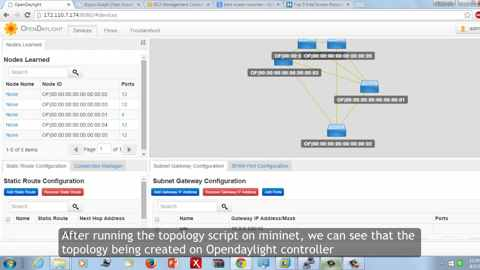
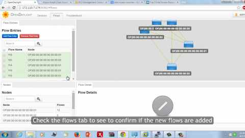
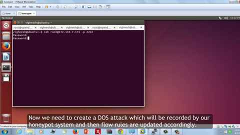
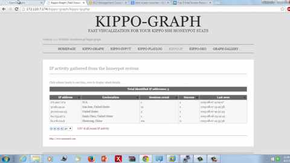
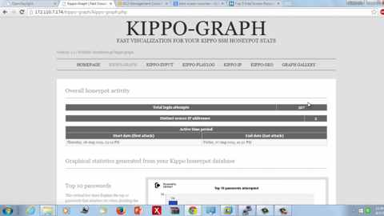
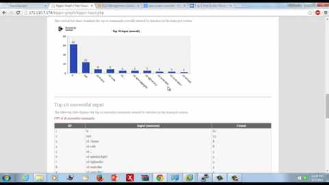
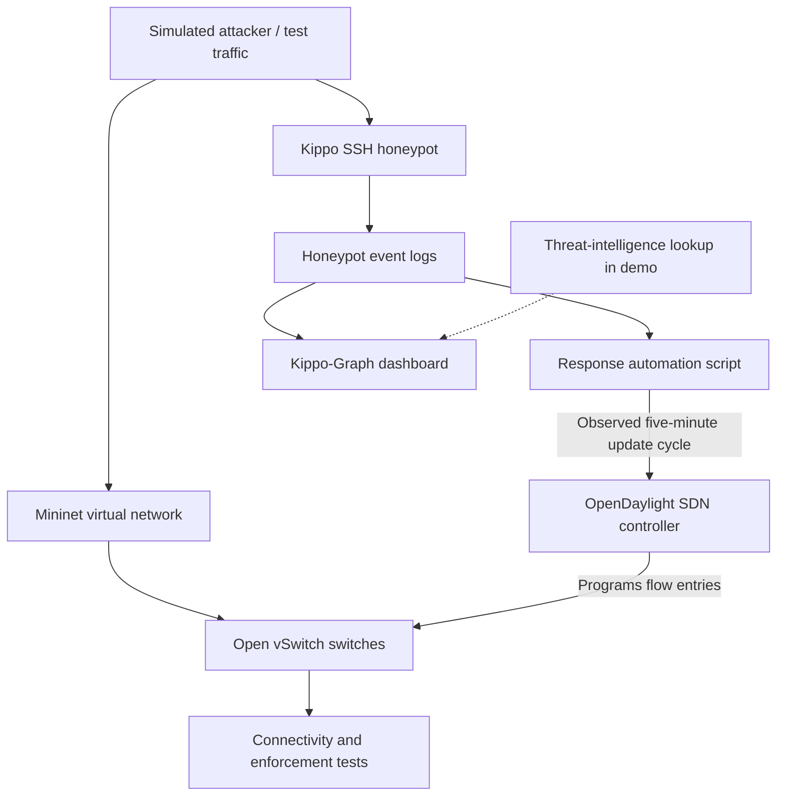

# SDN-Based Intrusion Response Using a Honeypot

**Master's Final-Year Project | San José State University | 2015**  
**M.S. Software Engineering — Cloud Computing and Virtualization**

> **Archive reconstruction (2026):** This repository documents a 2015 student group project from a surviving demonstration recording and a July 13, 2015 project-status email. It is a historical portfolio case study, **not** a claim that the complete original source code, configurations, measurements, or deployment are available here. Technical details labeled *inferred* should be checked against surviving project materials.

## Repository guide

Two distinct eras are kept separate so historical work is not confused with current software:

| Area | Contents | Status |
| --- | --- | --- |
| [`archive/2015/`](archive/2015/) | Recovered original Mininet topology, unchanged | 2015 historical artifact; do not assume modern compatibility |
| [`src/`](src/) | Modern Python 3 log analysis and read-only response proposals | 2026 reconstruction; does not make controller changes |
| [`tests/`](tests/) | Unit tests for the 2026 modules | Python standard-library tests |
| [`docs/PYTHON3_MODERNIZATION.md`](docs/PYTHON3_MODERNIZATION.md) | Migration scope and explicit limits | Documentation |

**What is and is not modernized:** the original `network_topology.py` is deliberately preserved as it was written. The two original controller scripts have *not* been committed as historical source because they contain insecure legacy configuration. Instead, files with the same names in `src/` are entirely new **read-only replacements**. They are not drop-in ports of the legacy controller automation. Flow-rule programming, authenticated controller integration, and production-grade detection remain out of scope.

### Run the modern demonstration

```bash
python -m unittest discover -s tests -v
python src/AutomatedScriptOnAttack.py --log path/to/sanitized-kippo.log --switch-id s2
```

The second command emits JSON proposals for manual review. It does not connect to an SDN controller.

## Overview

This project explored an automated network defense workflow using **software-defined networking (SDN)** and a **honeypot**. A virtual network was created using **Mininet** and **Open vSwitch (OVS)**, with **OpenDaylight** managing network topology and flow rules. An attacker-interaction honeypot captured suspicious activity. A script then used information from honeypot activity to update network rules, aiming to restrict traffic from identified suspicious IP addresses. Dashboards were used to review the attack evidence.

The project is a useful early example of **programmable network security**: instead of changing each switch manually, the controller and automation can coordinate responses across a simulated network.

## Demonstration at a glance

| Area | Evidence seen in 2015 recording |
| --- | --- |
| Cloud host | Ubuntu instance shown running on Amazon Web Services (AWS) |
| Emulated network | Mininet-created topology with switches and hosts |
| Controller | OpenDaylight web interface showing topology, nodes and flow entries |
| Baseline validation | Terminal tests showing host connectivity and successful pings |
| Traffic control | Flow entries applied to Open vSwitch; terminal/API-based output shown |
| Attack telemetry | Honeypot activity captured and represented in Kippo-Graph |
| Automated response | Narration describes a script processing honeypot logs and updating flow rules every **five minutes** |
| Analysis | Blacklisted IPs and attack statistics shown; an AlienVault threat-intelligence page is also displayed |
| Retest | Connectivity tests repeated after changes to flow rules |

### Project screenshots

The following seven frames are from the archived 2015 demonstration recording and are presented in recording order.

**1. SDN topology and controller**



**2. Network flow and connectivity testing**



**3. Controller and topology inspection**



**4. Attack simulation and response workflow**



**5. Response automation and flow management**



**6. Honeypot activity analytics**



**7. Threat intelligence and attack analysis**


## Architecture

The following is a **conceptual reconstruction**, not a recovered original architecture diagram:



### How the workflow operated

1. **Create the testbed.** Launch a Mininet topology with hosts and OVS switches in an Ubuntu environment; the recording includes an AWS-hosted Ubuntu instance.
2. **Connect the SDN controller.** Use OpenDaylight to observe connected nodes and network topology.
3. **Establish initial connectivity.** Add flow entries and run ping/connectivity tests to verify reachability.
4. **Generate simulated malicious activity.** Drive test interactions against an SSH honeypot in the controlled lab.
5. **Capture evidence.** Record attacker interactions and visualize their activity with Kippo-Graph.
6. **Apply defensive changes.** Run an automation script that reads honeypot-derived information and updates SDN flow rules; the recording describes an approximately five-minute refresh interval.
7. **Validate the response.** Inspect updated rules / blacklisted IPs and repeat network connectivity tests.
8. **Investigate activity.** Review historical dashboards and a demonstrated threat-intelligence lookup.

## Technology stack

| Layer | Technology | Role |
| --- | --- | --- |
| Cloud / operating system | AWS EC2 (Ubuntu instance shown) | Lab environment |
| Network emulation | Mininet | Simulated hosts and switches |
| Virtual switching | Open vSwitch | Software forwarding and flow-table enforcement |
| SDN control plane | OpenDaylight (Helium release referenced in email) | Controller-based topology and flow management |
| Controller integration | Legacy OpenDaylight REST APIs and JSON | Exact historical API paths are visible in recovered scripts, but no modern connector is implemented |
| Honeypot | Kippo | Capture SSH attacker interactions |
| Reporting | Kippo-Graph | Visualizations of honeypot logs and attacker commands |
| Threat intelligence | AlienVault OTX / related AlienVault site shown | Demonstration of suspicious-IP research |
| Automation | Python 2 scripts in 2015; Python 3 read-only reconstruction in 2026 | Historical scripts used controller APIs; modern scripts only emit review proposals |

## Timeline and evidence

**July 13, 2015 — progress email:** The student team reported that it had designed the attack-simulation network; deployed the network with Mininet; worked with an updated OpenDaylight Helium controller; designed switch flow rules; and built a honeypot-oriented monitoring module. The same email listed **dynamic flow-table updates, REST/JSON processing, and web hosting as work in progress**.

**Recorded final demonstration — undated:** The supplied ~11-minute video shows the controller and topology, baseline network tests, flow-related commands, a scripted honeypot-to-flow response, blacklisted addresses, Kippo-Graph analytics, and connectivity retesting. This supports saying the *demo presented* an automated response path; it does **not**, on its own, prove a production-ready implementation, scale, detection accuracy, or independently validated protection against every attack type.

## Engineering challenges and lessons

- **Control versus data plane:** Separating forwarding behavior in OVS from policy orchestration in OpenDaylight.
- **Dynamic policy:** Bridging raw attacker events and controller-managed flow tables rather than relying only on static rules.
- **End-to-end observability:** Combining flow-table inspection, terminal network testing, honeypot logs and a reporting dashboard.
- **Safe experimentation:** Using a virtualized and isolated lab for repeatable connectivity and attack simulations.
- **Feedback loop:** Rechecking network behavior after flow-rule changes to establish whether an intended restriction took effect.

## What this archive does *not* contain

- The full original codebase, original controller scripts in this public repo, complete flow-table configurations, honeypot configuration, deployment instructions, or the final academic report.
- Verified throughput, latency, true-positive / false-positive detection metrics, or independently reproducible benchmarks.
- Confirmed names of every contributor or a precise division of responsibilities.

**Do not run historical commands directly on public infrastructure.** Mininet, OpenDaylight Helium and Kippo versions from 2015 are obsolete; reproduce the idea only in an isolated environment using maintained tools and reviewed configurations.

## Project contributors and attribution

This was a **team-based San José State University master's project**, and the supplied July 2015 progress email was sent by **Ranjitha Kannambadi** to the professor and project participants, including **Vighnesh Naik**. Other project participants named in the email include **Akhil** and **Jayandran**; their full names and individual responsibilities have not been verified. **Richard** was addressed as professor; his full name has not been verified. This portfolio documents team work and does not attribute all implementation to one individual.

## Artifacts and provenance

- **Primary artifact:** an approximately 11-minute 2015 project demo recording supplied by a project participant (not committed here, to keep the repository lightweight and avoid public release without review).
- **Supporting artifact:** July 13, 2015 project-status email supplied by a participant (summarized, not reproduced with personal email addresses).
- **Screenshots:** extracted from the supplied demonstration video for portfolio documentation; not yet uploaded to this repository.
- **README:** reconstructed in October 2026; interpret as a retrospective rather than an original 2015 design document.

## Potential future revival

A modern reimplementation could evaluate **Containernet or Mininet**, **OVS**, a maintained SDN controller or programmable networking approach, a contemporary honeypot such as **Cowrie** (successor to Kippo), and structured events driving a reviewed policy engine. These are *proposals*, not claims about the 2015 build.

---

**Portfolio keywords:** Software-Defined Networking · OpenDaylight · Mininet · Open vSwitch · Honeypot · Kippo · AWS · Network Security · Network Automation · Threat Detection · REST APIs
